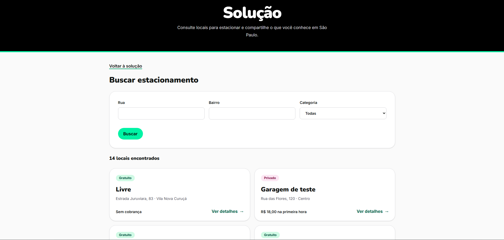
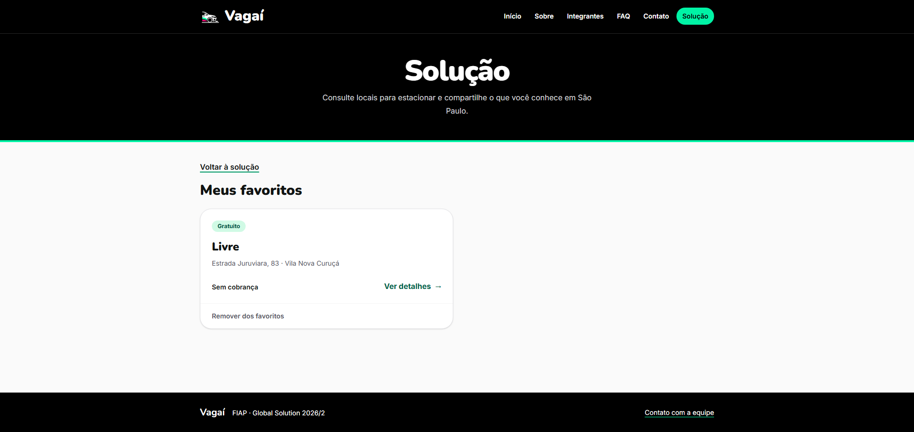
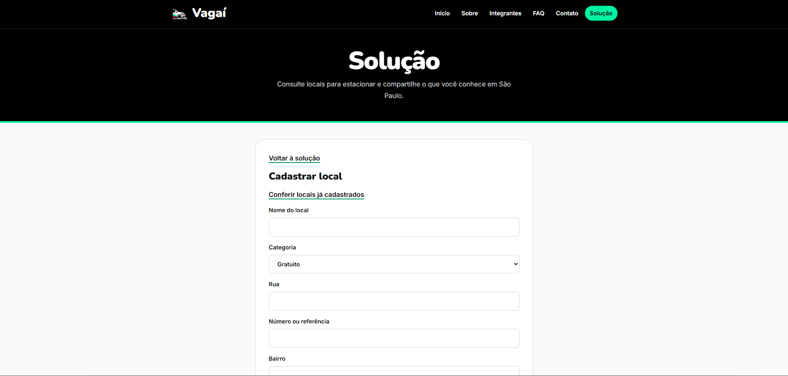

# Vagaí — Estacionamento colaborativo em São Paulo

- **Aplicação publicada na Vercel:**
- **Vídeo de apresentação no YouTube:**


## Descrição do projeto

O **Vagaí** é um projeto da **Global Solution 2026/2 da FIAP**, no tema **CitizenTech**. A ideia surgiu entre os integrantes que dirigem em São Paulo e conhecem a dificuldade de estacionar perto do destino. Na área **Solução**, qualquer pessoa pode consultar locais gratuitos, rotativos e privados. Quem entra na conta também pode cadastrar um local, compartilhar um relato, avaliar e salvar favoritos.

## Funcionalidades

- Navegação entre as páginas institucionais e a área Solução.
- Cadastro de conta, login por sessão e logout.
- Busca pública por rua, bairro e categoria, com endereço, tarifa e acesso aos detalhes.
- Consulta de horários, regras e avaliações, com rota externa pelo Google Maps.
- Cadastro de locais e inclusão de regras de uso pelo criador.
- Relatos de vaga em locais gratuitos e rotativos, visíveis como recentes por dez minutos.
- Avaliações de um a cinco pontos, com comentário opcional e atualização da própria nota.
- Lista pessoal de favoritos, com acesso aos detalhes e remoção de locais salvos.
- Página da equipe, formulário de contato com validação local, layout responsivo e página 404.

## Imagens do projeto

**Página inicial**

A pergunta “Onde posso estacionar perto do meu destino?” apresenta a proposta. O botão **Conheça a proposta** leva à seção sobre as dicas de quem já estaciona no bairro.


**Busca de estacionamentos**

O motorista pode combinar rua, bairro e categoria. Na captura, a busca exibe 14 locais. Os dois primeiros cards mostram a diferença entre um local gratuito e uma garagem que cobra R$ 18,00 pela primeira hora.



**Meus favoritos**

O local **Livre** aparece na lista pessoal com endereço e indicação de estacionamento gratuito. **Ver detalhes** abre o cadastro do local. **Remover dos favoritos** retira o item da lista do motorista.



**Cadastro de local**

O motorista pode conferir os locais já cadastrados antes de preencher o formulário. A captura mostra os campos de nome, categoria, rua, número ou referência e bairro, com a categoria **Gratuito** selecionada.



## Tecnologias utilizadas

- React
- TypeScript
- Vite
- Tailwind CSS
- React Router DOM
- React Hook Form
- Java 21, Spring Boot, JDBC e Oracle no backend
- Git e GitHub

## Como usar

- **Repositório GitHub:** [Vagaí](https://github.com/henriquemunizz/Vagai)
- **Aplicação publicada na Vercel:**
- **API Java publicada:** [Vagaí no Render](https://vagai-springboot.onrender.com/)
- **Repositório API no GitHub:** [Vagaí Spring Boot](https://github.com/henriquemunizz/vagai-springboot)
- **Vídeo de apresentação no YouTube:**

### Pré-requisitos

- Node.js 24 e npm instalados.
- API Java em execução com acesso ao esquema Oracle do Vagaí. O repositório do backend contém os scripts SQL e as instruções para configurar `ORACLE_URL`, `ORACLE_USER` e `ORACLE_PASSWORD`.

### Instalação

Na pasta do frontend, instale as dependências:

```bash
npm ci
```

### Execução em ambiente de desenvolvimento

Para usar o backend publicado, copie `.env.example` para `.env` e configure `VITE_API_URL=https://vagai-springboot.onrender.com`. Para trabalhar com a API local, use o seguinte valor:

```env
VITE_API_URL=http://localhost:8080
```

Inicie o frontend:

```bash
npm run dev
```

Abra [o Vagaí no navegador](http://localhost:5173). Reinicie o Vite após editar o `.env`. Na publicação, configure `VITE_API_URL` antes do build.

### Verificação do projeto

```bash
npm run lint
npm run build
```

## Rotas

| Rota | Página |
| --- | --- |
| `/` | Home |
| `/sobre` | Sobre o projeto |
| `/integrantes` | Integrantes |
| `/faq` | Perguntas frequentes |
| `/contato` | Contato |
| `/solucao` | Login, sessão e acesso às funcionalidades |
| `/solucao?modo=cadastro` | Cadastro de conta |
| `/solucao/locais` | Busca pública de estacionamentos |
| `/solucao/locais/:id` | Detalhes, regras, relatos e avaliações de um local |
| `/solucao/cadastrar` | Cadastro de local |
| `/solucao/favoritos` | Favoritos do motorista |
| `/membros` | Redirecionamento para Integrantes |
| `*` | Página não encontrada |

## Estrutura de pastas

```text
public/
├── fonts/               # Fontes Inter e Nunito e suas licenças
└── images/              # Marca, fotos dos integrantes e capturas do README

src/
├── components/          # Navegação e componentes compartilhados
├── data/                # Dados dos integrantes
├── pages/               # Páginas institucionais e 404
├── solution/            # Telas da solução, sessão e chamadas à API
├── types/               # Tipos compartilhados
├── App.tsx              # Rotas da aplicação
├── index.css            # Tailwind CSS e identidade visual
└── main.tsx             # Entrada do React
```

## Integração com a API

O cliente em `src/solution/api.ts` usa `fetch`. O arquivo `src/solution/routes.ts` carrega os dados das páginas e envia as ações de cadastro, login e colaboração. A busca consulta a API por rua e bairro e aplica a categoria escolhida à lista retornada.

### Sessão e origem local

- Configure `FRONTEND_ORIGIN=http://localhost:5173` no backend. Ao mudar a origem do frontend, atualize essa variável e reinicie a API.
- As chamadas usam `credentials: 'include'`. O navegador gerencia o cookie de sessão `JSESSIONID`, e `GET /usuarios/me` recupera o usuário conectado.
- Após criar uma conta, o motorista entra com nome e senha. Ao acessar uma função protegida, o login preserva o destino escolhido.
- Para HTTPS entre sites diferentes, configure `COOKIE_SECURE=true` e `COOKIE_SAME_SITE=none` no backend e permita o uso do cookie no navegador.

### Contratos utilizados

| Recurso | Campos |
| --- | --- |
| Cadastro e login | `nome`, `senha` |
| Usuário da sessão | `id`, `nome` |
| Estacionamento | `id`, `nome`, `descricao`, `tipo`, `rua`, `numero`, `bairro`, `primeiraHora`, `demaisHoras`, `idUsuarioCriador`, `ativo` |
| Regra | `id`, `idEstacionamento`, `diaSemana`, `inicio`, `fim`, `tipo`, `descricao`, `ativo` |
| Relato | `id`, `idEstacionamento`, `tipo`, `observacao`, `data`, `atual` |
| Avaliação | `id`, `idEstacionamento`, `idUsuario`, `nota`, `comentario` |
| Favorito | `id`, `idEstacionamento` |

O cadastro de estacionamento envia `GRATUITO`, `ROTATIVO` ou `PRIVADO`. Para locais privados, o motorista informa a primeira hora e a hora adicional. O cadastro do endereço permanece disponível para consulta. A janela de dez minutos se aplica aos relatos de vaga.

### Branch de integração

A branch `feature/integracao-api` reuniu o login, a busca e a colaboração. A `feature/cards-solucao` refinou os cards e a navegação. Ambas estão integradas à `develop`.

## Integrantes e créditos

### Henrique da Silva Muniz

- **RM:** 573874
- **Turma:** 1TDSPV-2026
- **GitHub:** [henriquemunizz](https://github.com/henriquemunizz)
- **LinkedIn:** [Henrique da Silva Muniz](https://www.linkedin.com/in/henrique-muniz-044b05365)

### Erick Keiji Miyashiro

- **RM:** 568966
- **Turma:** 1TDSPV-2026
- **GitHub:** [erickmiyashiro](https://github.com/erickmiyashiro)
- **LinkedIn:** [Erick Keiji Miyashiro](https://www.linkedin.com/in/erick-keiji-miyashiro-6228b93b4)

### Yuto Inoue

- **RM:** 573161
- **Turma:** 1TDSPV-2026
- **GitHub:** [yutoinouee](https://github.com/yutoinouee)
- **LinkedIn:** [Yuto Inoue](https://www.linkedin.com/in/yuto-inoue-713348373)

### Rafael Andres

- **RM:** 573700
- **Turma:** 1TDSPY-2026
- **GitHub:** [Andresxz1](https://github.com/Andresxz1)
- **LinkedIn:** [Rafael Andres](https://www.linkedin.com/in/rafaandres/)

### Vitor Rodrigues

- **RM:** 571297
- **Turma:** 1TDSPY-2026
- **GitHub:** [vitorf8](https://github.com/vitorf8)
- **LinkedIn:** [Vitor Rodrigues](https://www.linkedin.com/in/vitor-rodrigues-ferreira-22048a30b/)

## Contato

A página **Contato** reúne o acesso aos perfis da equipe. Para falar com um integrante, use o LinkedIn indicado nos créditos acima.

## Observação

Os endereços, valores e resultados nas capturas registram o estado da aplicação no momento das imagens. A lista exibida ao consultar o site depende dos locais cadastrados na API.
